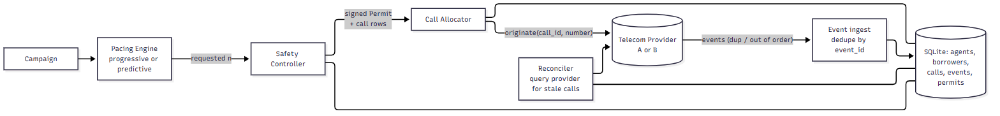
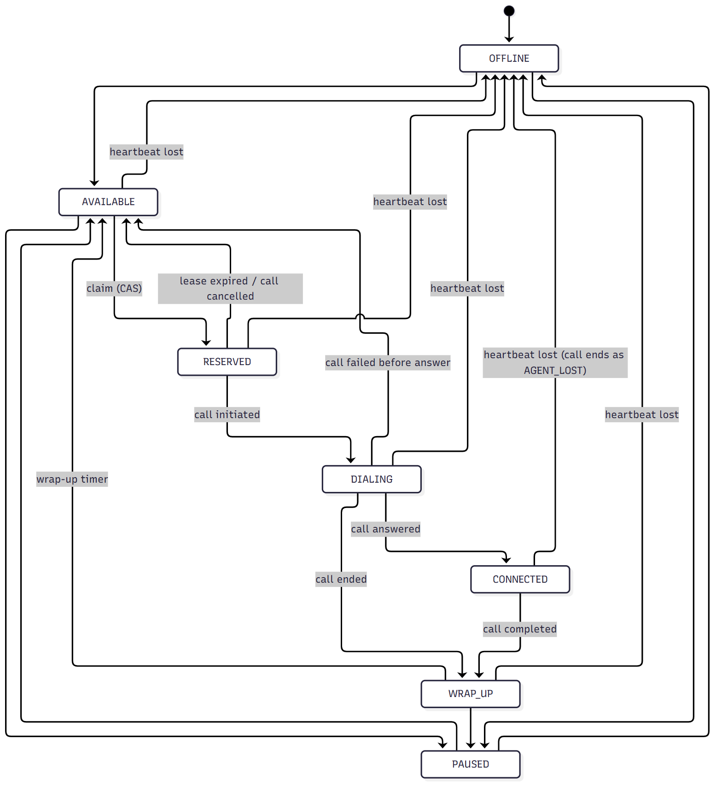
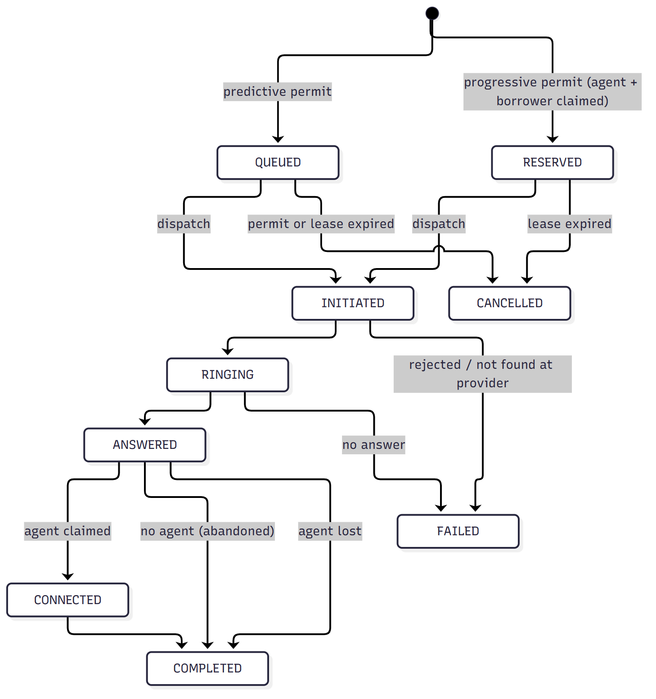

# SmartDialer: architecture (short version)

This is the one-page overview. The decisions are in [DECISIONS.md](DECISIONS.md). The full reasoning, including the failure analysis, pacing maths and scale notes, is in [DESIGN-DETAILS.md](DESIGN-DETAILS.md).

## 1. Components

- **Pacing engine** proposes how many calls to start. It cannot create calls.
- **Safety Controller** decides what is allowed, and signs each decision as a permit. It is the only code that creates call rows.
- **Call allocator** sends calls to a provider. It refuses any call without a valid, unspent permit.
- **Providers** are behind one interface. Provider A is fast and reliable. Provider B times out, duplicates events and reorders them.

Each worker runs one tick: ingest provider events, reconcile calls that have gone quiet, expire leases and vanished agents, then plan new calls.

## 2. State machines

Agent: AVAILABLE, RESERVED, DIALING, CONNECTED, WRAP_UP, plus OFFLINE and PAUSED. Illegal moves are rejected.

Call: provider events only move a call forward. A repeated event changes nothing. Terminal states (COMPLETED, FAILED, CANCELLED) never change.

## 3. Concurrency

Every claim is a compare-and-set: `UPDATE agents SET state='RESERVED' WHERE id=? AND state='AVAILABLE'`, then check that exactly one row changed. Two workers racing for one agent get one winner. The database is the only source of truth.

## 4. Failures

| Case | What happens |
|---|---|
| Worker crashes after reserving | The lease expires, and the agent and borrower are freed. |
| Worker crashes after INITIATED | Reconciliation asks the provider, finds no call, and the borrower is retried. |
| Worker crashes after ANSWERED | Reconciliation applies the provider's real state, and the agent is released. |
| Provider times out after placing a call | The call ID is the idempotency key, so the call is never dialled twice. |
| Duplicate or out-of-order events | Each event ID is stored once. A late event that would move a call backwards is ignored. |
| Provider outage | No new permits are issued. Existing calls finish when the provider recovers. Borrowers keep their retries. |
| Agent disappears during setup | The call is cancelled and the borrower is requeued. |

## 5. Predictive pacing

Dial n more calls only if the expected answers, plus a margin of 2.33 standard deviations (about 99%), fit the agents expected to be free within 10 seconds. The controller re-checks with the upper bound of the answer rate, so uncertainty means fewer calls. It falls back to progressive dialing when the abandon rate over the last 100 outcomes is above 3%, or when the last 30 outcomes show a significant surge in answers.

## 6. Stack choices

| Choice | Why | What it makes harder |
|---|---|---|
| Python, standard library only | Runs with no installation | Slower than Go or Rust |
| SQLite in WAL mode | Correct transactions with no extra service | One writer, one host |
| Signed, single-use permits | The controller's decision cannot be forged or replayed | The secret lives in one process |
| Events deduplicated by ID | Repeated and reordered events are harmless | Side effects still depend on arrival order |

## 7. Scale

Measured on one Windows machine, single process:

- **1,000 agents:** 9.0 ticks per second.
- **10,000 agents:** 2.5 ticks per second, after fixing the first bottleneck. Before the fix it was 0.3.
- **First bottleneck (fixed):** a claim query sorted every waiting borrower because the index did not cover the sort. Adding covering indexes made five ticks take 1.8 seconds instead of 22.
- **Next bottleneck:** one database transaction per provider event. Batching events per tick would fix it.
- **Ceiling:** the single SQLite writer. Beyond that, the fix is Postgres with row-level locks, and heartbeats moved to an in-memory store.

## 8. Least confident

- Answers in one batch are not independent. A provider starting answering-machine detection moves the whole batch, and the surge test catches that only after it starts.
- The pacing constants were tuned on the same five scenarios, so they are not held-out results.
- The fallback is sticky. It can cost utilisation for a while after the problem has passed.

## 9. The final question

How would you get as much of predictive dialing's utilisation as possible while keeping progressive dialing's deterministic safety?

Make the safety property a data-flow fact, not a tuning. Every call that can reach a provider must come from one serialised decision that checks agent availability against the upper bound of the answer rate. Inside that boundary, predict aggressively: learn the answer rate quickly, dial only into agents that are provably free, and fall back to agent-first progressive claims whenever the assumptions break. Utilisation comes from the accuracy of the estimate. Safety comes from a ceiling that no estimate can exceed.
