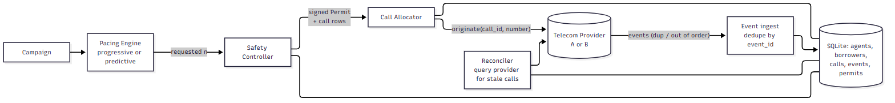
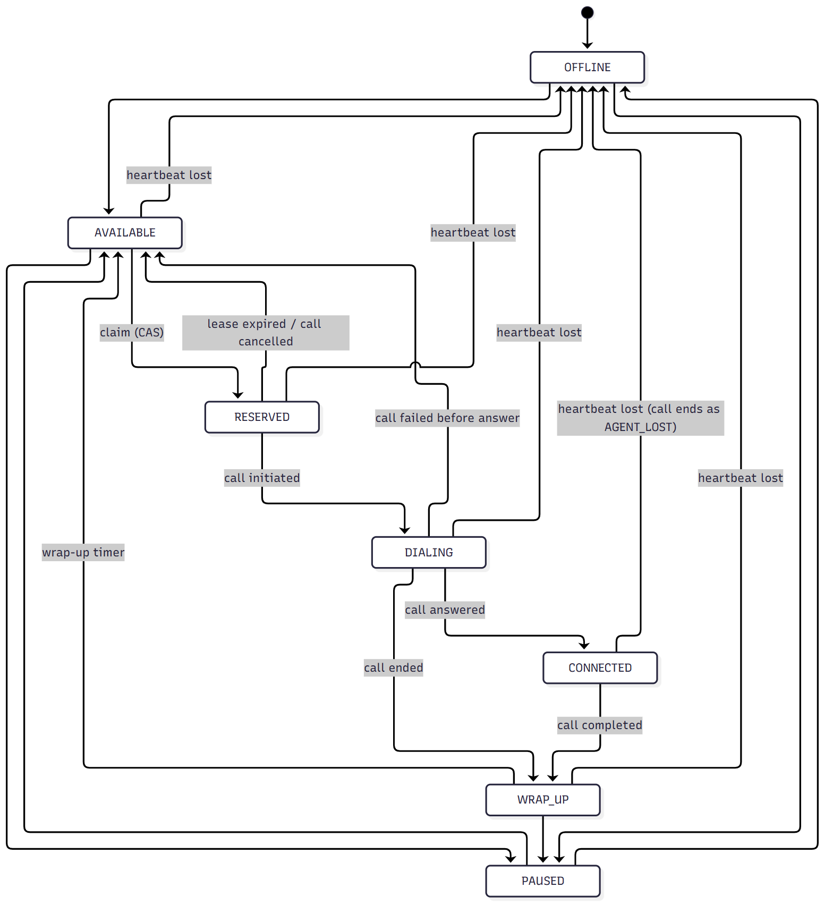
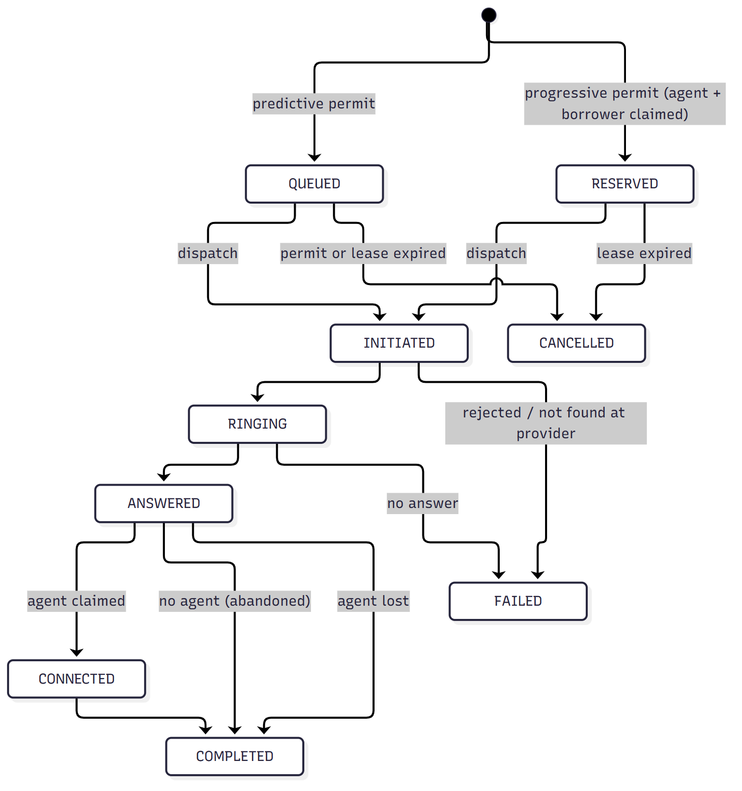

# SmartDialer: full design details

This is the long version. The short overview is in [ARCHITECTURE.md](ARCHITECTURE.md). The decisions are in [DECISIONS.md](DECISIONS.md). The Mermaid sources for the diagrams sit beside the PNG files.

This document covers the design, the state machines, the concurrency argument,
the failure cases, the pacing maths, the scale analysis, and the answer to the
final question in the assignment.

## 1. Architecture



Only the Safety Controller can create call rows. Only the Call Allocator can
talk to a provider, and it refuses to dial anything that is not inside a valid,
unexpired, not-yet-dispatched permit signed by the controller. The pacing engine
has no write path to calls and no provider handle.

Each worker is a `Dialer` process running `tick()`:

1. ingest provider events (deduplicated);
2. reconcile calls whose outcome has gone quiet (query the provider);
3. sweep: expire leases, release vanished agents, finish wrap-ups;
4. plan: pacing proposes, the controller decides, the allocator dispatches.

## 2. Agent state machine



Illegal moves raise an error (`AGENT_TRANSITIONS` in `model.py`).

## 3. Call state machine



The rule that makes events safe to replay and reorder, `next_call_state()`:

* a terminal state never changes;
* re-delivering the current state is a no-op;
* a terminal event always wins;
* a non-terminal event is applied only if it moves the call forward.

So `ANSWERED, ANSWERED, ANSWERED, COMPLETED` leaves the call COMPLETED with
one transition, `COMPLETED, ANSWERED, RINGING` leaves it COMPLETED, and a late
`RINGING` after `ANSWERED` is ignored.

## 4. Concurrency: why two workers can't take the same agent

Every change of state is a compare-and-set:

```sql
UPDATE agents SET state='RESERVED', version=version+1
 WHERE id=? AND state='AVAILABLE';   -- rowcount must be 1
```

Claims run inside `BEGIN IMMEDIATE`, so SQLite serialises writers, and the CAS
predicate means that even without the lock a second claimer gets rowcount 0.
`tests/test_dialer.py::test_two_workers_cannot_both_reserve_the_same_agent`
runs eight threads with eight connections against one agent. Exactly one wins.

**Your database says AVAILABLE and your cache says RESERVED: which wins?**
There is no cache. The database is the only source of truth; any cache is a
read-only hint and every decision is re-checked by a CAS inside the write
transaction. A stale hint can waste one attempt, but it cannot double-allocate.

## 5. Failure cases

| Case | What happens |
|---|---|
| Worker crash after agent and borrower reserved | Permit not dispatched. The call stays RESERVED/QUEUED. After `lease_secs` the sweep cancels it, frees the agent, and requeues the borrower. Test: `test_worker_crash_after_reserve_releases_agent_and_borrower`. |
| Worker crash after INITIATED is committed, before provider call | Call is INITIATED with no provider evidence. Reconciler queries with the call id as idempotency key, gets None after `originate_timeout`, marks FAILED (NOT_FOUND), and the borrower is retried. |
| Worker crash after ANSWERED | Agent is DIALING/CONNECTED, call is ANSWERED. Reconciler queries the provider and applies its real state (COMPLETED), releasing the agent to WRAP_UP. If the provider has no record, the call is marked COMPLETED (LOST) and the agent is released. Test: `test_crash_right_after_answered_is_reconciled`. |
| Ambiguous timeout (call placed, ack lost) | Reconciler finds the call via query. The idempotency key means a retry never dials twice. Test: `test_ambiguous_timeout_is_reconciled_without_double_dial`. |
| Provider starts timing out | Each timeout counts toward a per-provider circuit breaker. After `breaker_threshold` consecutive errors it opens for `breaker_cooldown`. While open: the controller rejects new permits (`PROVIDER_UNAVAILABLE`), so no new calls are created. Existing calls are reconciled by query. Reserved-but-undispatched calls expire via lease. Pacing sees no provider health, so it stops. |
| Provider outage with events backlogged | Events are queued at the provider and delivered late. Late events are stale or duplicate and are handled by the state machine. |
| Agent disappears during setup | Heartbeat expires; `expire_vanished_agents` cancels the active call (provider `hangup`), marks the agent OFFLINE, and requeues the borrower. Test: `test_agent_vanishing_during_setup_cancels_call_and_requeues_borrower`. |
| Duplicate event | Primary key on `event_id` makes the second insert a no-op. Test: `test_duplicate_provider_event_creates_one_transition`. |
| Out-of-order event | Forward-only rule ignores it. Tests in `StateMachineTests` and `test_answered_answered_answered_completed`. |

## 6. Predictive pacing: the maths

Let `k = in_flight + n` (calls already going plus the new ones),
`p` the answer rate, and `supply` the agents we expect to be able to take a
call within the horizon.

```
expected answers   mu = k * p
noise              sd = sqrt(k * p * (1 - p))
dial n only if     mu + z * sd <= supply
```

* `p` is a posterior mean with a prior (`default_answer_rate`, `prior_weight`),
  using decayed counts (`decay`), so it adapts within roughly 50 outcomes.
* `supply` is agents AVAILABLE now, plus a fraction (`connected_weight`, 0.25)
  of agents in WRAP_UP or CONNECTED that are expected to be free within
  `horizon` (10s) seconds. The fraction is deliberately below 1: a CONNECTED
  agent's talk time is uncertain, and a ringing call can answer before it ends.
* `z = 2.33` is about 99%: we accept a 1% chance of more answers than agents
  in any one tick.

The pacing engine proposes `n`. The Safety Controller then:

1. re-reads state inside its transaction;
2. recomputes the ceiling with the **upper** confidence bound of `p`, so
   uncertainty always makes it dial less;
3. enforces an in-flight cap of `max_in_flight_per_agent * logged_in`;
4. trips to progressive fallback if the abandon rate over the last 100
   outcomes exceeds 3%, or if the last 30 outcomes show a statistically
   significant surge in answers (one-sided z-test, z > 2.5, against the
   estimate). The fallback is progressive, but it keeps back agents for
   predictive calls already ringing (`pending_unbound`, with the same
   z-sigma allowance), so those answers still find an agent.

**Why did the system decide to make N calls instead of M?** Every tick logs the
inputs (`p_hat`, `in_flight`, `supply`, `proposed`) and the outcome
(`safety_log.reason`). Worked example: `p = 0.49`, 12 calls in flight,
supply 18, `z = 2.33`.

| n | k = 12+n | mu = k·p | sd = √(k·p·(1−p)) | mu + z·sd | allowed (≤ 18)? |
|---|---|---|---|---|---|
| 5 | 17 | 8.33 | 2.06 | 13.1 | yes |
| 10 | 22 | 10.78 | 2.34 | 16.2 | yes |
| 12 | 24 | 11.76 | 2.45 | 17.5 | yes |
| 13 | 25 | 12.25 | 2.50 | 18.1 | **no** |

So the pacer may dial 12 here, not 13. The controller also re-checks with the
upper-bound `p`, which can cut this further.

**Answer rate drops from 70% to 10%.** The estimator decays towards the new
rate within about 50 outcomes, so pacing raises calls to refill agents. That
raises utilisation risk, not compliance risk, and it is bounded by
`max_new_per_tick` and the in-flight cap. The compliance risk is the reverse
case, answers rising suddenly. That is caught by the shock rule (a z-test of
the last 30 outcomes against the estimate), which falls back to progressive at once. The
abandon-rate check is the second line of defence.

## 7. Choices of stack and why

| Choice | Why | What it makes harder |
|---|---|---|
| Python, standard library only | Runs with no installs; the assignment is about reasoning, not frameworks. | Slower than Go or Rust; no real async I/O. |
| SQLite (WAL) as the shared store | Several worker processes on one host share correct transactions with no extra service. CAS maps one-to-one to Postgres. | One writer at a time; will not scale across hosts (see section 8). |
| Event log in the same DB as state | Dedupe and state change are one transaction, so a crash cannot leave one without the other. | Table grows; needs retention. |
| HMAC-signed permits | Makes "pacing can't dial" a property enforced by the data flow, not by convention. | Permits are in-process secrets; a distributed system would need a shared key service. |
| Circuit breaker held per worker | Simple, no coordination. | Each worker learns about an outage on its own; a shared breaker would react faster. |
| No Kafka, Redis or queue | The unit of coordination is one row per call, and SQLite handles that load at prototype scale. | At 10,000 agents you need a real database and an explicit queue. |

## 8. Scale: what breaks first

Ordered by when they fail as the agent count grows:

Measured first, then the ceiling. Profiling five ticks at 10,000 agents and
60,000 borrowers (`cProfile`) found where the time went.

1. **A missing claim index (found and fixed).** 20.5 of 22 seconds went to one
   query: finding the next waiting borrower. The index covered the filter but not
   the sort, so every claim sorted all waiting rows. Adding indexes that cover the
   ORDER BY (`ix_borrowers_claim`, `ix_agents_claim`) cut the five ticks from
   22.0 s to 1.8 s, about 12 times faster. The claim order is unchanged, and scenario A
   gives identical results before and after.
2. **One transaction per provider event (the next bottleneck).** After the index
   fix, about 1.0 s of the 1.8 s goes to applying provider events, one transaction
   each. Batching events per tick would remove most of that.
3. **The single SQLite writer (the ceiling).** Every tick still takes the one write
   lock for heartbeats, events, claims and snapshots. Load test at 10,000 agents:
   reservation race exactly-once in 1.8 s; dialer 2.5 ticks per second (30 ticks
   in 11.9 s). Beyond that, the fix is Postgres with row-level locks, and heartbeats
   moved to an in-memory store with a TTL.
4. **The snapshot query.** `snapshot()` counts agents and calls on every
   planning step. The fix is to maintain counters incrementally, updated in the
   same transactions as the state changes, instead of recounting.
5. **The reconciler.** It runs the same query over all stale calls each tick.
   At scale, reconciliation has to be driven by a timer wheel per call, not a
   scan.
6. **Provider rate limits.** Each provider has a call-setup rate limit. The
   allocator needs a token bucket per provider; without one, a burst of
   permits becomes a burst of rejections.
7. **Cross-host coordination.** Two hosts cannot share a SQLite file. At that
   point the CAS is the same SQL over Postgres and the permit key moves to a
   secret store.

I would not fix this with more servers. Adding workers to one SQLite file
makes the write lock the bottleneck sooner. The right fix is a partition: shard
campaigns or agent teams across databases, so that each campaign's pacing sees
its own agents and nothing global.

## 9. The part I'm least confident about

The answer-rate model assumes that answers are independent across calls within
a tick. In reality answers cluster: a provider that starts returning
answering-machine detection, or a time-of-day effect, moves the whole batch at
once. The shock rule catches the clustering after it has started. A better
model would give each batch its own answer-rate, or use the provider's own
answer-machine signal. The 3% abandon target is also a design parameter here,
not something the prototype has been checked against a regulator.

## 10. The final question

> *How would you build a SmartDialer that gets as much of the utilisation
> benefit of predictive dialing as possible, while retaining the deterministic
> safety characteristics of progressive dialing?*

Make the safety property a data-flow fact, not a tuning. Every call row that can
reach a provider must have been created by a single, serialised decision that
checked agent availability against the upper bound of the answer rate. Then
predict aggressively *inside* that boundary: learn `p` quickly, dial to fill
the supply that is provably free, and fall back to agent-first progressive
claims whenever the boundary's assumptions break (shock, abandon rate, provider
health). Utilisation comes from accuracy of the estimate. Safety comes from a
ceiling that cannot be exceeded whatever the estimate says.
