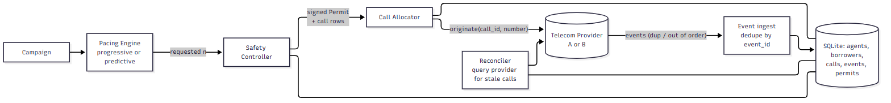
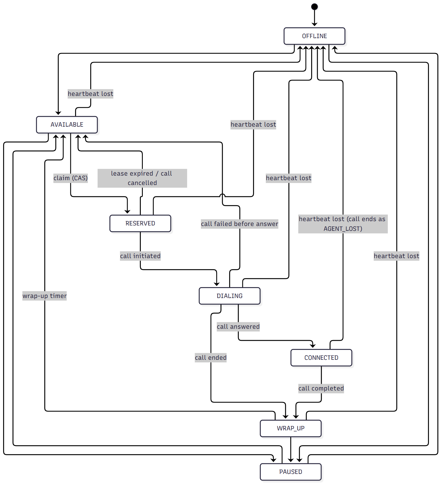
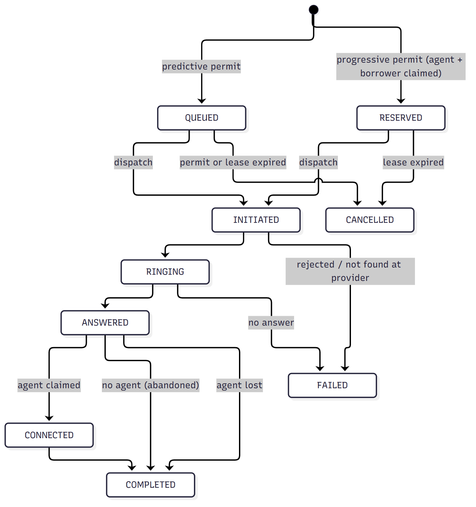

# SmartDialer prototype

A working prototype of a collections SmartDialer: progressive and predictive
dialing, a Safety Controller between pacing and the telecom provider, explicit
agent and call state machines, two mock providers that behave differently, and
tests for the failure cases in the assignment.

Design, state machines, failure analysis and scale notes are in
[ARCHITECTURE.md](ARCHITECTURE.md) (short overview) and [DESIGN-DETAILS.md](DESIGN-DETAILS.md) (full reasoning).

## Start here

| What you want | Where it is |
|---|---|
| The short answer to the final question | [Final answer](#final-answer) below |
| The architecture in one page | [ARCHITECTURE.md](ARCHITECTURE.md) |
| The decisions, options and trade-offs | [DECISIONS.md](DECISIONS.md) |
| The full design reasoning | [DESIGN-DETAILS.md](DESIGN-DETAILS.md) |
| The diagrams | [Diagrams](#diagrams) below |
| Simulation results | [Results](#results) below, and [sim_results.txt](sim_results.txt) |
| Load test results | [loadtest_10000.txt](loadtest_10000.txt) |
| Where each requirement is in the code | [Code map](#where-to-find-each-requirement-in-the-code) below |
| Run everything yourself | [Setup](#setup) and the commands below |

## Requirements

* Python 3. No third-party packages. Tested on Windows with Python 3.13 only.

## Setup

```powershell
git clone https://github.com/rishikeshpathi2007-sketch/Smart-dialer.git
cd Smart-dialer
```

## Run the tests (about 1 second)

```powershell
python -m unittest discover -s tests -v
```

## Run the simulation

Runs scenarios A to E (20%, 50%, 70% answer rates; changing rates with a
provider outage; sudden loss of 40% of agents) in both modes:

Full run (about 80 seconds on the test machine):

```powershell
python -m smartdialer.simulate --agents 50 --duration 1800
```

Quick check (about 30 seconds). It runs 300 simulated seconds per scenario, so the numbers differ from the full run:

```powershell
python -m smartdialer.simulate --quick
```

## Run the load test (under 15 seconds)

```powershell
python -m smartdialer.loadtest --agents 1000 --borrowers 20000 --ticks 120
```

For 10,000 agents, which takes about 12 seconds:

```powershell
python -m smartdialer.loadtest --agents 10000 --borrowers 60000 --ticks 30
```

## Layout

| File | Role |
|---|---|
| `smartdialer/model.py` | Agent and call state machines, call-event rules, config |
| `smartdialer/store.py` | SQLite persistence, CAS reservations, write-ahead dispatch, snapshots |
| `smartdialer/providers.py` | Provider interface; `provider_a` (fast, reliable) and `provider_b` (slow, timeouts, duplicates, reordering) |
| `smartdialer/progressive.py` | Progressive dialer: one free agent, one call; fallback budget that protects ringing predictive calls |
| `smartdialer/pacing.py` | Predictive pacing engine (proposes only) |
| `smartdialer/safety.py` | Safety Controller: sole creator of calls; signed permits; fallback rules |
| `smartdialer/allocator.py` | Call Allocator: sole caller of providers; circuit breaker |
| `smartdialer/dialer.py` | Worker tick: ingest, reconcile, sweep, plan, dispatch |
| `smartdialer/simulate.py` | Scenario runner |
| `smartdialer/loadtest.py` | Reservation race and tick throughput |
| `tests/test_dialer.py` | 25 unit tests for races, crashes, duplicates, out-of-order events, outages and permits |
| `ARCHITECTURE.md` | Short overview: diagrams, state machines, failures, pacing, scale |
| `DESIGN-DETAILS.md` | Full design reasoning, with the same diagrams |
| `architecture.png`, `agent-state-machine.png`, `call-state-machine.png` | Architecture and state-machine diagrams as PNG, with Mermaid sources (`.mmd`) |
| `DECISIONS.md` | Short decision record: each choice, its options, its costs, and what was left out |

## How the pieces connect

```
Campaign > Pacing Engine (propose n) > Safety Controller (decide, sign permit)
         > Call Allocator (dispatch) > Telecom Provider
```

The pacing engine cannot create calls. The controller is the only code that
writes call rows, and the allocator only dials calls that belong to a valid,
unexpired, not-yet-dispatched permit.

## Diagrams

Architecture: pacing proposes, the safety controller decides, the allocator dials.



Agent state machine:



Call state machine:



## Where to find each requirement in the code

Line numbers are for the current commit.

| Requirement | File | Key function (line) |
|---|---|---|
| Progressive dialer | `smartdialer/progressive.py` | `ProgressiveDialer.request_size` (29), `spare_agents` (33). The agent and borrower claims are in `store.py`, `reserve_progressive` (252) |
| Predictive pacing engine | `smartdialer/pacing.py` | `max_new_calls` (28), `PacingEngine.propose` (45) |
| Safety controller | `smartdialer/safety.py` | `SafetyController.authorize` (71), `_surge` (133), `verify` (66) |
| Call allocator (the only code that dials) | `smartdialer/allocator.py` | `CallAllocator.dispatch` (83) |
| Mock providers A and B | `smartdialer/providers.py` | `MockProvider.originate` (104), `provider_a` (169), `provider_b` (178) |
| Agent and call state machines | `smartdialer/model.py` | `AGENT_TRANSITIONS`, `next_call_state` (82) |
| Two workers cannot claim one agent | `smartdialer/store.py` | `_cas` (201), `_claim_agent` (217) |
| Write-ahead dispatch | `smartdialer/store.py` | `begin_dispatch` (301) |
| Duplicate and out-of-order events | `smartdialer/store.py` | `apply_event` (330), `_transition` (367) |
| Crash recovery and reconciliation | `smartdialer/dialer.py` | `Dialer._reconcile` (54) |
| Agent disappears during setup | `smartdialer/store.py` | `expire_vanished_agents` (509) |
| Worker loop (one tick) | `smartdialer/dialer.py` | `Dialer.tick` (36) |
| Simulation | `smartdialer/simulate.py` | `scenarios`, `run` |
| Load test | `smartdialer/loadtest.py` | `reservation_race`, `tick_throughput` |
| Tests (25) | `tests/test_dialer.py` | run with `python -m unittest discover -s tests -v` |

## Results

Full run: `python -m smartdialer.simulate --agents 50 --duration 1800`
(50 agents, 30 simulated minutes, seeded and deterministic). Raw output is in
[sim_results.txt](sim_results.txt).

| Scenario | Mode | Utilisation | Dialed | Answered | Connected | Abandoned | Abandon % |
|---|---|---|---|---|---|---|---|
| A: 20% answer, 120s talk | progressive | 47.1% | 2023 | 367 | 367 | 0 | 0.0% |
| A: 20% answer, 120s talk | predictive | 66.6% | 2571 | 524 | 524 | 0 | 0.0% |
| B: 50% answer, 90s talk | progressive | 68.5% | 1411 | 704 | 704 | 0 | 0.0% |
| B: 50% answer, 90s talk | predictive | 73.6% | 1468 | 757 | 757 | 0 | 0.0% |
| C: 70% answer, 180s talk | progressive | 86.5% | 667 | 457 | 457 | 0 | 0.0% |
| C: 70% answer, 180s talk | predictive | 87.5% | 671 | 470 | 464 | 6 | 1.3% |
| D: 70% to 10% to 50%, provider A outage 900-960s | progressive | 63.7% | 1439 | 498 | 498 | 0 | 0.0% |
| D: 70% to 10% to 50%, provider A outage 900-960s | predictive | 72.8% | 2050 | 578 | 566 | 12 | 2.1% |
| E: 50% answer, 40% of agents stop heartbeating at 600s | progressive | 74.0% | 853 | 426 | 426 | 0 | 0.0% |
| E: 50% answer, 40% of agents stop heartbeating at 600s | predictive | 76.8% | 906 | 444 | 444 | 0 | 0.0% |

Pacing, averaged over the ticks where the controller was consulted (from the same run):

| Scenario | Mode | Avg answer-rate estimate | Avg proposed | Avg granted | Avg in flight | Avg supply |
|---|---|---|---|---|---|---|
| A: 20% answer | progressive | 0.205 | 1.8 | 1.81 | 23.4 | 1.8 |
| A: 20% answer | predictive | 0.228 | 16.9 | 1.46 | 30.5 | 16.9 |
| B: 50% answer | progressive | 0.466 | 1.5 | 1.49 | 12.7 | 1.5 |
| B: 50% answer | predictive | 0.486 | 4.1 | 0.83 | 13.3 | 13.3 |
| C: 70% answer | progressive | 0.613 | 1.3 | 1.30 | 5.0 | 1.3 |
| C: 70% answer | predictive | 0.629 | 1.2 | 0.38 | 5.1 | 6.3 |
| D: changing rates | progressive | 0.375 | 1.7 | 1.72 | 18.4 | 1.7 |
| D: changing rates | predictive | 0.412 | 12.4 | 1.17 | 24.0 | 12.4 |
| E: 40% agents drop | progressive | 0.460 | 1.4 | 1.36 | 7.7 | 1.4 |
| E: 40% agents drop | predictive | 0.465 | 2.7 | 0.51 | 8.6 | 9.0 |

Read it this way. In predictive mode, "proposed" is what pacing asks for and "granted"
is what the controller allows after its upper-bound check. For example, in scenario A
pacing proposes 16.9 calls per tick on average and the controller grants 1.46. The gap is
the safety margin at work. "Avg supply" is the agents expected to be free within the
10-second horizon. Progressive rows show supply equal to the free agents, because that
is the only limit in progressive mode.

Scenario E at the assignment's exact size (100 agents, 40 of them drop out),
run separately:

| Mode | Utilisation | Answered | Abandoned | Abandon % | Lost agents detected |
|---|---|---|---|---|---|
| progressive | 74.9% | 869 | 0 | 0.0% | 15s |
| predictive | 79.3% | 915 | 5 | 0.5% | 15s |

Utilisation = agent-seconds in CONNECTED / agent-seconds logged in (WRAP_UP counts as idle).
In scenario E the dialer noticed the lost agents 15s after they stopped
heartbeating (the heartbeat timeout), and cancelled their calls.

**How to read this.** Predictive mode beats progressive on utilisation in every
scenario, most at low answer rates (67% vs 47% at 20%). The abandon rate stays
under the 3% limit in every run. Two caveats:

* The pacing constants (`z`, `horizon`, `connected_weight`, the shock test)
  were tuned against these same scenarios, so this is not a held-out result.
  Scenario D in particular drove the shock-test fix.
* Predictive mode spends much of its time in progressive fallback at higher
  answer rates (for example 304 of 1800 ticks in scenario C). That is the
  safety design working as intended, but it means the utilisation gain is
  smaller there.

### Load test

Run it with `python -m smartdialer.loadtest --agents <n> --borrowers <m> --ticks <t>`.
Results on one Windows machine, single process, SQLite:

| Agents | Borrowers | Race (8 threads) | Race exactly-once | Dialer | Dials |
|---|---|---|---|---|---|
| 1,000 | 20,000 | 0.81 s | yes | 60 ticks in 6.6 s (9.0 ticks/s) | 2,735 |
| 10,000 | 60,000 | 1.82 s | yes | 30 ticks in 11.9 s (2.5 ticks/s) | 5,991 |

The first 10,000-agent run took 107.7 s for 30 ticks (0.3 ticks/s). Profiling found the
cause: a claim query sorted every waiting borrower, because the index did not cover the
sort order. Adding claim indexes (`ix_borrowers_claim`, `ix_agents_claim`) made that run
about 12 times faster. Scenario A's results were checked to be identical before and after.
The next bottleneck is one database transaction per provider event; see section 8 of
`DESIGN-DETAILS.md`.

The 1,000-agent figures above are from the re-run after the index change. The earlier
1,000-agent run in this README came before the fallback fix, so its dial count differs.

## If something does not work

- **`python` is not found.** On Windows, try `py` instead of `python`, for example `py -m unittest discover -s tests`. If neither works, install Python 3 from python.org.
- **Module not found, or nothing runs.** Run the commands from the repository folder, the one that contains `smartdialer` and `tests`.
- **Check the Python version.** Run `python --version`. The code was tested with Python 3.13.
- **Save the simulation output to a file.** The simulation prints to the terminal. To keep a copy, run `python -m smartdialer.simulate > sim_results.txt`.
- **No git installed.** On the GitHub page, choose Code, then Download ZIP. Unzip it, and open PowerShell in the unzipped folder.

## Final answer

**Question:** How would you get as much of predictive dialing's utilisation as possible while keeping progressive dialing's deterministic safety?

Make the safety property a data-flow fact, not a tuning. Every call that can reach a provider must come from one serialised decision that checks agent availability against the upper bound of the answer rate. Inside that boundary, predict aggressively: learn the answer rate quickly, dial only into agents that are provably free, and fall back to agent-first progressive claims whenever the assumptions break. Utilisation comes from the accuracy of the estimate. Safety comes from a ceiling that no estimate can exceed.

The longer discussion is in [ARCHITECTURE.md](ARCHITECTURE.md), section 9, and [DESIGN-DETAILS.md](DESIGN-DETAILS.md), section 10.

## Limitations

* SQLite on one host: several worker processes share a correct database, but
  there is no multi-host coordination. See section 8 of `DESIGN-DETAILS.md`.
* The providers are simulated. The `Provider` interface is what a real
  integration would implement.
* The 3% abandon threshold is a design parameter, not a compliance check.
